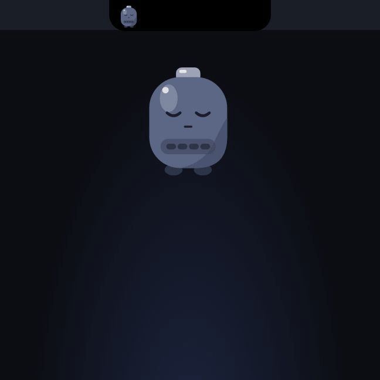

# Pilas

The little pilita on the notch that tells you when Claude Code needs you.
Approve permissions, answer questions and jump to the right terminal without
switching windows.

<p align="center"></p>

<p align="center">
  
</p>

The latest version is on
[GitHub Releases](https://github.com/HurgotDev/pilas-app/releases). The scope
of v1 is in `docs/SPEC.md` and the progress in `docs/PLAN.md` (both in
Spanish).

## What it does

- An island on the notch (or on the top edge of the screen) with the pilita,
  which changes state: asleep, loading, alert and full.
- A list of Claude Code sessions with their status and last action.
- Approve permissions (**Allow**, **Deny**, **Always**) and answer Claude
  Code's questions without switching windows, or send them back to the
  terminal.
- Stays out of the way while you are already in the session that asks: if
  its Ghostty tab is focused, Pilas leaves the request to Claude Code's own
  prompt in the terminal, without opening the island or playing a sound.
- Click a session to jump to its exact Ghostty tab; with other terminals, it
  brings the app to the front.
- Prompt cache temperature: each session shows whether Claude Code's prompt
  cache for its main conversation is warm, cooling or cold (or compacted
  while idle), so you can decide whether to keep going or `/compact`. Pilas
  detects each session's cache lifetime (1 hour or 5 minutes) from its
  transcript. When a cache starts cooling, the pilita shivers, an optional
  sound plays and the pill shows a countdown; click it to jump to that
  session's terminal. Configure it under **Prompt cache** in Settings
  (**Cache temperature**, **Warn before it cools**, **Sound when cooling**).
- Optional 8-bit sounds; interface in English and Spanish.
- Seasonal costumes: from October 15 to November 2 the pilita dresses up
  for Halloween, with its own sounds, a bat flying across the island and
  pumpkin counters; from December 1 to 26 it wears a Santa hat, with
  jingle-bell sounds, snow falling on the island, a troll snowman that
  wanders around and bauble counters. Pick
  **Automatic**, **Classic**, **Halloween** or **Christmas** under
  **Costume** in Settings.

Privacy: no accounts and no telemetry. The only internet connection is the
update check, which can be turned off.
For the cache temperature, Pilas reads only the usage numbers at the end of
each session's local transcript; it never stores or logs its content.

## Installation

Pilas is for macOS 13 or later.

With Homebrew (recommended). The cask removes the quarantine flag for you, so
you don't need `xattr`:

```bash
brew install --cask hurgotdev/tap/pilas
```

Or download the `.dmg`:

1. Download the `.dmg` of the latest version from
   [GitHub Releases](https://github.com/HurgotDev/pilas-app/releases).
2. Open the `.dmg` and drag **Pilas** to **Applications**.

Pilas is not signed or notarized, so macOS will block it the first time. There
are two ways to allow it:

- In Terminal (recommended):

  ```bash
  xattr -dr com.apple.quarantine /Applications/Pilas.app
  ```

  This removes the quarantine flag from the app and from the `pilas-hook`
  binary it includes, before Pilas copies it to its data folder.

- In **System Settings → Privacy & Security**, click **Open Anyway** after the
  first attempt. In recent versions of macOS, right-click → Open no longer
  bypasses this block.

On first launch, the onboarding opens, installs the hooks in Claude Code and
lets you choose whether Pilas launches at login.
After that, the pilita icon in the menu bar gives you access to **Settings…**.

If you installed the hooks with a version before the cache temperature,
Settings shows them as **Needs repair**: click **Repair** to add the new
`PreCompact` hook. Your other hooks and your status line are left untouched.

Pilas checks for updates at startup and every 24 hours, and tells you in the
menu bar and in Settings. It does not install anything unless you ask it to.
To turn off the check, clear **Check for updates automatically** in
**Settings…**.

To uninstall, open **Settings…** and click **Disconnect** to remove the hooks
from `~/.claude/settings.json`. Then delete `Pilas.app` and the folder
`~/Library/Application Support/Pilas`.

## Requirements for development

- macOS 13 or later, Xcode Command Line Tools (`xcode-select --install`)
- Stable Rust (`curl https://sh.rustup.rs -sSf | sh`)
- Node 20 or later
- Claude Code and Ghostty ≥ 1.3 to test end to end

```bash
npm install
npm run app          # opens Pilas in development mode
npm run build        # the app needs dist/ to compile and pass tests
cargo clippy --workspace -- -D warnings
cargo test --workspace
npm run typecheck && npm run test:scripts
```

To test the hooks without affecting your own Claude Code sessions, follow
`docs/HOOKS-DEV.md` (in Spanish).

## Contributing

Create your branch (`feat/<slug>` or `fix/<slug>`) from `develop`, add a
fragment in `.changes/` (see `.changes/README.md`) and open the PR into
`develop`.

## Publishing a version

Merging a release PR into `main` publishes a version automatically. The full
process (branches, changelog, releases and hotfixes) is in
`docs/RELEASING.md` (in Spanish).

## License

MIT. See `LICENSE`.
